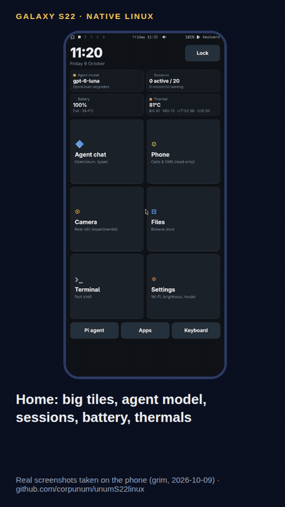
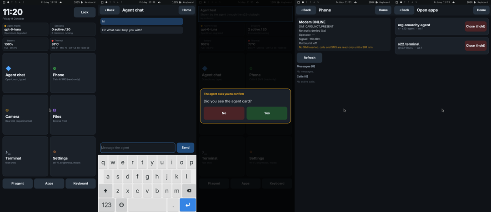

# 📱 unumS22linux

**A Galaxy S22 that boots its own Linux. No Android underneath. AI agents wrote the drivers.**

## The story

I don't write code. I had an old **Samsung Galaxy S22** (Exynos 2200, `SM-S901B/DS`) and an idea:
could AI agents turn it into a real Linux computer, with no Android services at all?

They did most of it. Agents (Claude, GPT Luna through my framework
[OpenUnum](https://corpunum.com), and a local Qwen running on the phone itself) wrote the custom
`/init`, the boot handoff, the persistence layer and the drivers glue. **Other agents reviewed
every step**, adversarially, before anything touched the phone. Every claim below has a log, a
measurement or a screenshot behind it, and the failures are written down too: the
[experiment log](EXPERIMENTS.md) is 2,800 lines long.

Today the phone boots from its RECOVERY partition into Linux, joins Wi-Fi and Tailscale, runs a
touch desktop, keeps two local language models loaded, and runs my agent, which can text, talk
and drive its own screen.

## See it

<table>
<tr>
<td width="34%"></td>
<td>

**A walkthrough of real screenshots**, taken on the phone with `grim` (2026-10-09):

- **Home:** big tiles plus live cards for the agent model, sessions, battery and temperature.
- **Agent chat:** tap the field, the on-screen keyboard appears; type "hi", the agent replies.
- **The agent drives the screen:** an OpenUnum tool shows a card and asks a question; a tap on
  *Yes* goes back to the agent.
- **Phone, camera, files, settings** (the camera screenshot predates the working capture path), edge swipes for home / back / switcher, and a Power-key
  lock cover.

All screenshots: [evidence/touchui-20261009](evidence/touchui-20261009/README.md).

</td>
</tr>
</table>

## What works, and what doesn't (yet)

| | |
|---|---|
| ✅ **Boot** | Native Linux from RECOVERY with our own `/init`; no Android services; reboots without touching the phone (`s22-reboot recovery`) |
| ✅ **System** | Persistent Arch Linux ARM + Hyprland on internal storage; starts by itself after a reboot |
| ✅ **Network** | Wi-Fi with autostart, Tailscale, USB SSH; mobile data over the modem with 5G NSA (LTE + NR n78, ~97 Mbit/s down measured) |
| ✅ **AI** | Stock Samsung NPU models (`.nnc`) run on the NPU through ENN (16/17 stock models, e.g. face parsing in 3.7 ms); local 2B model on the GPU (Samsung's Vulkan driver in an isolated runtime) and 4B on the CPU; OpenUnum agent with GPT Luna by default and the local model as offline fallback |
| ✅ **Phone stack** | SIM and SMS ready through our own modem daemon (`s22-phoned`, outbound off by default) |
| ✅ **Voice** | The phone talks through its own speaker (English + two Greek voices); push-to-talk or the Talk button; while the agent thinks it plays short "hmm, let me check…" clips and speaks its thinking |
| ✅ **Touch UI** | Our own Rust shell drawing straight to the display: a tap opens a page in ~10–12 ms (the old shell: 63 ms), 11 MB of memory; home, agent chat with streaming, phone, files, camera, settings, EN/GR keyboard, lock, agent cards, 5G/4G badge. Samsung's GPU driver can also draw to the screen with zero copy |
| 🟡 **Bluetooth** | Controller comes up by itself after boot; no pairing or audio yet |
| 🟡 **Sensors** | Accelerometer, gyro, magnetometer and light frames read; no calibration or auto-rotate |
| ✅ **Camera** | Rear and front cameras through our own capture path (no Android camera stack). Photos are processed by our own software ISP (demosaic, white balance, stock colour matrix, multi-frame noise reduction); the shell's Camera page takes and shows them in ~2 s. Short videos under 1 frame/s |
| ✅ **Audio** | Speaker and microphone work, both directly and through Samsung's DSP graph (the phone's mic hears its own speaker: a 1 kHz test tone at ~1000× the noise floor); earpiece and calls not yet |
| 🟡 **GPS** | The GNSS chip runs under Linux with Samsung's own engine and tracks real satellites (indoors so far: 1–2 satellites, no position fix yet) |
| ❌ **Calls, custom NPU models, suspend** | Not working yet |

Full hardware table and every earlier checkpoint: [docs/HISTORY.md](docs/HISTORY.md).
Current details: [STATUS.md](STATUS.md).

**Driver people: help is very welcome**, especially on camera image processing, the
NPU and calls. Open an issue, or read the [driver task board](docs/S22_LUNA_TASK_BOARD_2026-10-02.md) first.

<b>🔧 How it boots, and the safety rules</b>

AOSP first-stage init does the hardware/module bootstrap, then hands off to our native guardian
before any Android service starts. Android recovery binaries stay on the phone for rescue. This
is not mainline Linux and not a chroot over a running Android: the Arch desktop runs over native
Alpine.

- Userdata was converted to ext4 after a private backup and with the owner's explicit approval;
  CACHE holds the base overlay. No MISC, PIT, EFS, IMEI, bootloader or TrustZone changes.
- A hash-verified Lineage recovery rollback stays available before any image experiment.
- `s22-reboot recovery` restarts without buttons; a failed software path can still need a
  physical recovery.
- Boot mode is checked from `/proc/boot_reset`, never from the splash screen.

Current RECOVERY V3 SHA256:
`1a827b43d29141efb47f530902dd4e4ee2b6d780515893c9ecd676ad27efd7d1`.

<b>📦 What is in this repo</b>

- [EXPERIMENTS.md](EXPERIMENTS.md): the chronological log, failed tests included.
- [STATUS.md](STATUS.md): the current state and what is still open.
- [docs/NATIVE_LINUX.md](docs/NATIVE_LINUX.md): connecting, rebooting, storage and rollback.
- [docs/PERSISTENCE.md](docs/PERSISTENCE.md): internal storage and cold-boot decisions.
- `tools/`: the native handoff, headless recovery, rootfs, touch UI, phone daemon, OpenUnum
  phone plugins, model benchmarks and probes. `initramfs/cinit*.c`: the early custom-init work.
- `evidence/`: publishable logs, measurements and screenshots.

This is **not a one-command installer**: large local builds, downloaded packages and models,
vendor firmware and private backups are deliberately left out
([publication scope](docs/PUBLICATION.md)).

<b>📱 Other phones?</b>

Only the **SM-S901B/DS S22** has been tested. Never flash these images onto another model,
including an S22+ or Ultra. A researched list of phones with existing native Linux ports (OnePlus
6/6T, POCO F1, Fairphone 4 and more) is in [docs/OTHER_PHONES.md](docs/OTHER_PHONES.md).

---

Built by AI agents with [OpenUnum](https://corpunum.com) · sibling projects:
[UnumPingPong](https://github.com/corpunum/unumpingpong) (agents rally, a referee scores) and
[UnumSearch](https://github.com/corpunum/unumsearch) (fast code search for agents, running on this phone too)
