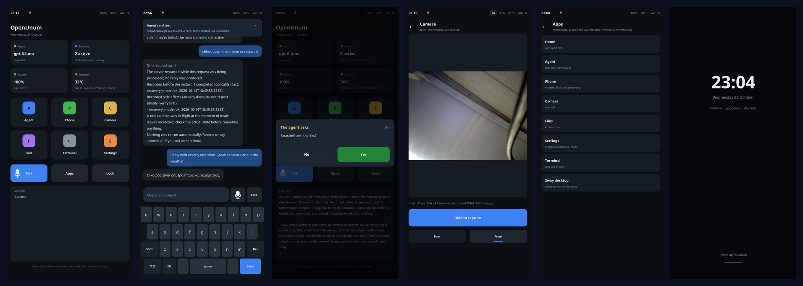

# 📱 unumS22linux

**A Galaxy S22 that boots its own Linux. No Android underneath. AI agents wrote the drivers.**

## The story

I don't write code. I had an old **Samsung Galaxy S22** (Exynos 2200, `SM-S901B/DS`) and an idea:
could AI agents turn it into a real Linux computer, with no Android services at all?

They did most of it. Agents (Claude, GPT Luna through my framework
[OpenUnum](https://corpunum.com), and a local Qwen running on the phone itself) wrote the custom
`/init`, the boot handoff, the persistence layer and the drivers glue. **Other agents reviewed
every step**, adversarially, before anything touched the phone. Every claim below has a log, a
measurement or a screenshot behind it, and the failures are written down too: the
[experiment log](EXPERIMENTS.md) is 2,800 lines long.

Today the phone boots from its RECOVERY partition into Linux and runs **our own Rust touch shell**
that draws straight to the display. It talks through its own speaker in English and Greek, takes
photos, is on 5G, runs AI models on Samsung's NPU and GPU, sleeps when locked, and runs my agent,
which can text, talk and drive its own screen.

## See it

**unum-fastshell**, our Rust shell (screenshots from the phone, 2026-10-21/22):

- **Fast:** a tap opens a page in **~9 ms** (the previous QML shell: 63 ms; the first desktop drew
  at ~3 frames/s). 11 MB of memory, 0.4% CPU when idle.
- **Agent chat** streams the answer as it arrives, with our own English/Greek keyboard; the **Talk**
  button runs the voice loop.
- **The agent drives the screen:** an OpenUnum tool asks a question, a tap on *Yes* goes back to it.
- **Camera** takes a 4-frame burst and shows a processed full-resolution photo in ~2 s.
- **5G / 4G badge**, app switcher, Power-key lock, and Power held 1 s to fall back to the old shell.

Older desktop walkthrough (10-09): [tour.gif](docs/media/tour.gif) ·
[evidence/touchui-20261009](evidence/touchui-20261009/README.md).

## What changed on 2026-10-21/22

Two days of agent work, every item measured on the phone:

| | Before | After |
|---|---|---|
| 🔊 **Audio** | "playback stalls, no DMA progress" | Speaker + mic work through Samsung's DSP graph. The bug: Android plays into virtual *calliope* devices, we wrote straight into the DSP's output end. Found by disassembling the stock audio library |
| 🗣️ **Voice** | render only, muted | The phone speaks (Whisper transcribes its own speaker exactly in Greek); fillers like "hmm, let me check…" while the agent thinks, and it speaks its thinking |
| 👆 **UI** | 63–120 ms per page | Rust KMS shell, ~9 ms; Samsung's Vulkan driver can also scan out with zero copy |
| 📷 **Camera** | raw Bayer frames | software ISP: demosaic, white balance, stock colour matrix, burst denoise |
| 📶 **Mobile** | "LTE only" | 5G NSA was already on (n78, 97 Mbit/s down); our modem daemon now sees it |
| 🔌 **Untethered** | internet through the USB cable | own SIM data with automatic Wi-Fi ⇄ mobile failover (~3 s); USB unplugged and Wi-Fi gone, still reachable over Tailscale (35–56 ms), even asleep |
| 🧠 **NPU** | one stock model | 16/17 stock models + our own TFLite models compiled on the phone (keyword spotting in 0.5 ms) |
| 🔋 **Battery** | 5.8 %/h locked | deep suspend: 1.1 %/h, still reachable over Tailscale |
| 🛰️ **GPS** | never powered | GNSS core runs in a sandbox, tracks real satellites (no fix indoors yet) |
| 📡 **Bluetooth** | manual start | comes up by itself after boot |

## What works, and what doesn't (yet)

| | |
|---|---|
| ✅ **Boot** | Native Linux from RECOVERY with our own `/init`; no Android services; reboots without touching the phone (`s22-reboot recovery`) |
| ✅ **System** | Persistent Arch Linux ARM + sway (under the Rust shell) on internal storage; starts by itself after a reboot |
| ✅ **Network** | Wi-Fi with autostart, Tailscale, USB SSH; mobile data over the modem with 5G NSA (LTE + NR n78, ~97 Mbit/s down measured); `s22-netpolicy` picks Wi-Fi > mobile > USB with automatic failover, so the phone works and stays reachable over Tailscale with no USB and no Wi-Fi (verified with the cable really unplugged) |
| ✅ **AI** | Stock Samsung NPU models (`.nnc`) run on the NPU through ENN (16/17 stock models, e.g. face parsing in 3.7 ms); our own TFLite models are compiled on the phone with Samsung's NPU compiler (keyword spotting in 0.34 ms, verified against the CPU); local 2B model on the GPU (Samsung's Vulkan driver in an isolated runtime) and 4B on the CPU; OpenUnum agent with GPT Luna by default and the local model as offline fallback |
| ✅ **Phone stack** | SIM and SMS ready through our own modem daemon (`s22-phoned`, outbound off by default) |
| ✅ **Voice** | The phone talks through its own speaker (English + two Greek voices); push-to-talk or the Talk button; while the agent thinks it plays short "hmm, let me check…" clips and speaks its thinking |
| ✅ **Touch UI** | Our own Rust shell drawing straight to the display: a tap opens a page in ~9–12 ms (the old shell: 63 ms), 11 MB of memory; home, agent chat with streaming, phone, files, camera, settings, EN/GR keyboard, lock, agent cards, 5G/4G badge. Samsung's GPU driver can also draw to the screen with zero copy |
| 🟡 **Bluetooth** | Controller comes up by itself after boot; no pairing or audio yet |
| 🟡 **Sensors** | Accelerometer, gyro, magnetometer and light frames read; no calibration or auto-rotate |
| ✅ **Camera** | Rear and front cameras through our own capture path (no Android camera stack). Photos are processed by our own software ISP (demosaic, white balance, stock colour matrix, multi-frame noise reduction); the shell's Camera page takes and shows them in ~2 s. Short videos under 1 frame/s |
| ✅ **Audio** | Speaker and microphone work, both directly and through Samsung's DSP graph (the phone's mic hears its own speaker: a 1 kHz test tone at ~1000× the noise floor); earpiece and calls not yet |
| 🟡 **GPS** | The GNSS chip runs under Linux with Samsung's own engine and tracks real satellites (indoors so far: 1–2 satellites, no position fix yet) |
| ✅ **Battery / suspend** | Locked, the phone suspends to RAM by itself (`s22-autosleep`) and still answers SSH over Wi-Fi/Tailscale: **36 mA (1.1 %/h) instead of 192 mA (5.8 %/h)** measured; wakes on Wi-Fi and the RTC alarm (Power key and incoming SMS not yet tested physically) |
| ❌ **Calls, NPU speech recognition** | Not working yet (the ASR model's wide kernels exceed the NPU compiler's limit) |

Full hardware table and every earlier checkpoint: [docs/HISTORY.md](docs/HISTORY.md).
Current details: [STATUS.md](STATUS.md).

**Driver people: help is very welcome**, especially on calls (IMS/VoLTE audio), wide-kernel
models on the NPU, camera colour tuning, GPS fix and Bluetooth audio. See the
[help-wanted issues](https://github.com/corpunum/unumS22linux/labels/help%20wanted) and
[how to work on them with your own agent](CONTRIBUTING.md#working-with-your-agent-on-this-repo).

<b>🔧 How it boots, and the safety rules</b>

AOSP first-stage init does the hardware/module bootstrap, then hands off to our native guardian
before any Android service starts. Android recovery binaries stay on the phone for rescue. This
is not mainline Linux and not a chroot over a running Android: the Arch desktop runs over native
Alpine.

- Userdata was converted to ext4 after a private backup and with the owner's explicit approval;
  CACHE holds the base overlay. No MISC, PIT, EFS, IMEI, bootloader or TrustZone changes.
- A hash-verified Lineage recovery rollback stays available before any image experiment.
- `s22-reboot recovery` restarts without buttons; a failed software path can still need a
  physical recovery.
- Boot mode is checked from `/proc/boot_reset`, never from the splash screen.

Current RECOVERY V3 SHA256:
`1a827b43d29141efb47f530902dd4e4ee2b6d780515893c9ecd676ad27efd7d1`.

<b>📦 What is in this repo</b>

- [EXPERIMENTS.md](EXPERIMENTS.md): the chronological log, failed tests included.
- [STATUS.md](STATUS.md): the current state and what is still open.
- [docs/NATIVE_LINUX.md](docs/NATIVE_LINUX.md): connecting, rebooting, storage and rollback.
- [docs/PERSISTENCE.md](docs/PERSISTENCE.md): internal storage and cold-boot decisions.
- `tools/`: the native handoff, headless recovery, rootfs, touch UI, phone daemon, OpenUnum
  phone plugins, model benchmarks and probes. `initramfs/cinit*.c`: the early custom-init work.
- `evidence/`: publishable logs, measurements and screenshots.

This is **not a one-command installer**: large local builds, downloaded packages and models,
vendor firmware and private backups are deliberately left out
([publication scope](docs/PUBLICATION.md)).

<b>📱 Other phones?</b>

Only the **SM-S901B/DS S22** has been tested. Never flash these images onto another model,
including an S22+ or Ultra. A researched list of phones with existing native Linux ports (OnePlus
6/6T, POCO F1, Fairphone 4 and more) is in [docs/OTHER_PHONES.md](docs/OTHER_PHONES.md).

## Try it on your phone

Want to do this on your own S22, a similar phone, or another Android phone? Read the
[porting guide](docs/PORTING.md) first: the warnings, which phones are close enough, the method we
used (agents reusing the phone's own vendor drivers, with a review loop before anything touches the
phone), and per-subsystem playbooks. Our Rust touch shell also runs on other Linux phones:
[tools/unum-fastshell/PORTING.md](tools/unum-fastshell/PORTING.md).

---

Built by AI agents with [OpenUnum](https://corpunum.com) · sibling projects:
[UnumPingPong](https://github.com/corpunum/unumpingpong) (agents rally, a referee scores) and
[UnumSearch](https://github.com/corpunum/unumsearch) (fast code search for agents, running on this phone too)
