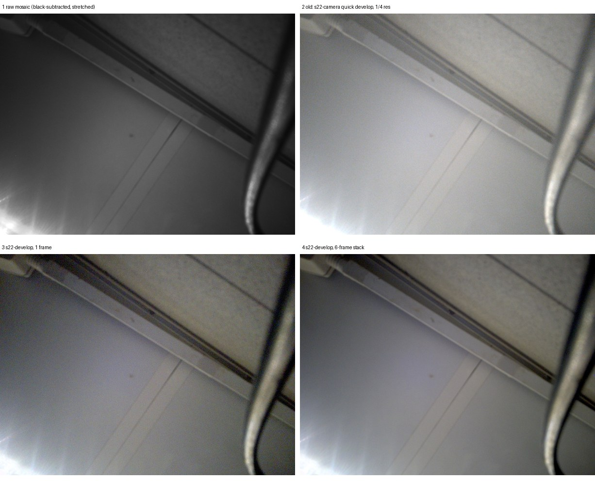

# Camera software ISP (s22-develop), shell Camera page, 5G badge — 2026-10-22

Scene: the room ceiling, through the front camera (IMX374). It was night, so the room lamp was the only light.
The rear camera lies lens-down on a surface, so its pictures show nothing useful.
No people or private items appear in any picture here.

## Before / after (same raw burst, front camera, 30 ms, 8x analog gain)

| File | What it is |
|---|---|
| [before-raw.jpg](before-raw.jpg) | The raw Bayer mosaic. Only black is subtracted and the levels stretched; no demosaic, WB or gamma. |
| [old-quick-develop.png](old-quick-develop.png) | The old picture: `s22-camera`'s pure-Python develop, 456x342 (1/4 resolution). |
| [after-single.jpg](after-single.jpg) | `s22-develop`, one frame, 1824x1368. |
| [after-stack.jpg](after-stack.jpg) | `s22-develop --stack`, the mean of a 6-frame burst, 1824x1368. |
| [after-noccm.jpg](after-noccm.jpg), [after-half.jpg](after-half.jpg) | Variants: without the colour matrix, and 2x2-binned (912x684). |
| [crop-100pct.jpg](crop-100pct.jpg) | 600x450 crops at 100 %: old (upscaled), one frame, stack. |
| [after-stack.json](after-stack.json), [after-single.json](after-single.json) | The tool's output: WB gains, CCM, offsets, exposure gain, timing. |

What the processing changes:
- full resolution instead of 1/4;
- colour from a demosaic and the stock colour matrix;
- flare/offset removal, so the picture has real contrast;
- in the stack, 3.1x less noise. High-pass luma noise in a flat ceiling patch was σ 7.05 for one frame and 2.24 for the stack, at the same mean level (114). That is more than the √6 ≈ 2.4 of averaging alone, because the stack also gets softer.

On the phone, one full-resolution frame develops in 0.31–0.40 s, and a 4-frame stack in 0.40–0.50 s.

## The real path: shell → touchd → camera → s22-develop

The test used injected touch, as in the earlier shell tests:
1. open Camera;
2. tap **Front**;
3. hold **Hold to capture** for 1.3 s.

touchd then:
- took a meter frame (10 ms, 2x);
- ran `s22-develop meter`, which chose 30 ms at 8x (the scene is dim);
- took a 4-frame burst;
- ran `s22-develop develop --stack`.

The whole run took 2.1 s. The shell showed the processed preview ([live-camera.png](live-camera.png), a real
scanout capture). touchd's result is [shell-camera.json](shell-camera.json). The full JPEG
went to the OpenUnum gallery: [shell-photo-front.jpg](shell-photo-front.jpg).
A rear capture through the same path also worked (30 ms, 16x, 4 frames, 2.2 s), but its scene is dark: the lens is on a surface.

## 5G badge

The shell reads s22-phoned `/status` every 20 s:
- **5G** when `radio.nr_nsa` is true, or `nr_last_seen` is less than 120 s old;
- **4G** when registered on LTE;
- no badge when not registered.

The test brought mobile data up with `s22-phoned mobile-data up`:
- NR n78 appeared after 2 s;
- the badge showed **5G** about 4 s later ([live-5g.png](live-5g.png));
- data went down again, and about 140 s later the badge was back to **4G**.

Routes (ecm0, wlan0) and Tailscale were unchanged. The test used almost no data: the data call was simply up for about 10 s.

## Tap → page re-measure (rebuilt shell)

`fs-tap-latency.py 0.822 0.507 10 --hold 60` (Settings tile), on the rebuilt binary:
- page p50 9.4 ms (max 13.5);
- highlight p50 8.6 ms;
- touch-down → page p50 71.5 ms.

Earlier results were 12.1 ms (first run) and 18.4 ms (after the reboot). Raw: [fastshell-tap-latency.json](fastshell-tap-latency.json).

## Not verified

- **Colour accuracy.** There is no chart, and the only scene is a near-neutral ceiling. The CCM was found by a heuristic scan
  of the stock setfiles (see CAMERA.md). Which illuminant each matrix belongs to is not decoded, and the
  GN3 and IMX374 setfiles contain the same tables.
- **Orientation.** The preview is shown as the sensor delivers it. Which rotation makes it upright when you hold the phone was not checked.
- **Rear camera in real light.** Not tested: the phone lies lens-down. Its dark frames show a blue cast in the shadows, and the cause was not found.
- **Lens shading.** The correction is a generic radial gain (k = 0.35), not the stock LSC tables.
- **Physical touch.** Not tested by a real finger; all taps were injected.
- **NPU denoise/HDR.** Not tried, for lack of time. The stock models need their exact input layouts, and one wrong model crashed the phone before.

## Deployed (2026-10-22, phone)

| File | sha256 | Backup / rollback |
|---|---|---|
| `/srv/s22/hardware/bin/s22-develop` | `4024a083…` | new file (remove it: touchd falls back to the old quick PNG) |
| `/srv/s22/hardware/bin/s22-camera` (+ `s22-camera.py`) | `861795fc…` (only `--raw-burst` added) | `s22-camera.bak-20261022T010210`, `s22-camera.py.bak-20261022T010210` |
| `/srv/s22/hardware/bin/unum-fastshell` | `cd8caf6c…` | `/srv/s22/state/fastshell/backup-20261021-220808/` (also holds the previous s22-touchd) |
| `/srv/s22/hardware/bin/s22-touchd` | `9ea26414…` | same backup dir; `install-fastshell.sh --rollback` restores it |

Only s22-touchd was restarted (by exact PID, through `install-fastshell.sh`); the shell came back with it.
