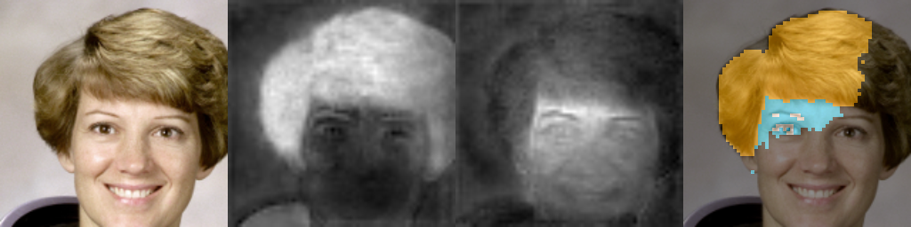

# NPU on this boot — 2026-10-21/22

Owner request: "npu was working" — establish the current truth, measure it, make one demo.
No flashing, no module swap (no rmmod), no partition writes. Only the stock `npu` module.

## Result

**Verified on device:** the Exynos 2200 NPU runs stock Samsung `.nnc` models from Linux
through Samsung's ENN user library, inside the isolated Bionic runtime
(`/srv/s22/enn-rt`, same idea as the GPU llama path). **16 of 17 stock models run**.
One model (it contains a DSP section) **crashed the phone** (watchdog reset; it rebooted by itself).
The demo is face parsing (hair/skin maps) of a real photo in 3.7 ms on the NPU.

### 1. The 10-07 result reproduces exactly
After `npu-bootup-once` (BOOTUP rc 0, `exynos_s2mpu_verify_subsystem_fw: DNC FW[0] is verified!`),
the stock object detector `OD_V3.5.2_08_31_VGA_PAMIR_ENN_BGRA.nnc` ran **3000 times**:
mean **3.14 ms**, p50 3.23, p99 3.66, max 5.14 ms (about 320/s). The output checksums are
**byte-identical to 2026-10-07** (`492a7bbd…`, `b16c3392…`). During the run, NPU devfreq was 1066 MHz,
DNC devfreq was 935 MHz (idle: 160–267 MHz), and the process held 2 × `/dev/vertex10`.
[od-vga-3000.log](od-vga-3000.log)

### 2. Every stock model (`enn-run`, 30 runs each, constant input)
The `.nnc` files come from the private stock vendor extraction
(`rootfs/npu-vendor-assets-decompressed/`). The shape column is the raw dims that
`EnnGetBufferInfoByIndex` reports (dim order varies by model).

| Model | Input 0 (shape, bytes) | p50 ms | What it is (from name) |
|---|---|---|---|
| OD_V3.5.2 VGA BGRA | 1x4x640x480, 1.2 MB | 2.62 | object detection (2 heads 80x60) |
| OD_V3.4.3 QVGA BGRA | 1x4x320x240 | 2.08 | object detection (10 heads, SSD-like pyramid) |
| PhotoParsing6 AWB FACE 256 | 1x256x256x3 | 3.66 | face parsing, 6 classes @64x64 |
| PhotoParsing5 AWB FACE 256 | 1x256x256x3 | 3.69 | face parsing, 5 classes @64x64 |
| PhotoParsing5 AF FACE 128 "DSP" | 1x128x128x3 | 2.15 | face parsing, 5 classes @32x32 (ran on NPU, no DSP section) |
| SRIBMidas aiHDR Global INT16 | 1x512x512x12 | 30.5 | HDR global → 128-vector |
| SRIBMidas aiHDR Local INT16 | 512x512x12 + 32x32x128 | 26.8 | HDR local map |
| B2BSFNet (3 variants) | 1x1120x864x4, 15.5 MB | 83.0 | camera image network |
| denoise e374 / e89 | 1x1088x832x4 → x12 | 122 / 120 | RAW denoise |
| denoise e2500 / e2265 | 336x1024x27 / 544x1056x12 | 66 / 101 | denoise (DCT) |
| 56_HDR fp16 | 1x336x1024x27 | 64 | HDR fusion |
| 18 fp16 1217 | 896x960x12 + 896x960x1 | 198 | camera fusion |
| **SRIB_HumanSegVideo INT8** | — | **crash** | person segmentation; has a `DSP_BINARY` section |

[sweep2.log](sweep2.log) (open rc, every buffer, latency, checksums).
No audio models ship in the stock vendor image: there are no keyword-spotting, ASR or TTS `.nnc` files.
New models need Samsung's proprietary compiler, so voice on the NPU is still not possible.
(The vendor does ship `libnpu_compiler.so` / `libsait_npu_compiler.so` / `libeden_ud_npu.so`. These
are the on-device NNAPI/Eden compiler path, which is untested; see Next.)

### 3. Crash: models with a DSP section kill the phone
The first sweep loaded `SRIB_HumanSegVideo_INT8` right after the OD model. The NPU firmware
started a **DSP task** (`dsp_task_control_power … TASK_dsp() enter`). The DSP firmware closure is
not staged on this Linux. Then: `SMU: IP_DNC (DRAM) READ PAGE FAULT at 0x33500000` →
`npu_util_dump_handle_error_k` → `WDTRESET right now!`. The phone rebooted (`/proc/reset_reason` = DPON)
and came back on its own about 1 min later, with Wi-Fi, Tailscale, modem and phoned all up.
The files written just before the crash were lost (zero-filled, ext4 delalloc). They were re-copied
and checked against sha256.
[crash-humanseg-dsp-lastkmsg.txt](crash-humanseg-dsp-lastkmsg.txt)
**Rule:** `grep -q DSP_BINARY model.nnc` → do not load it. `tools/hardware/npu/enn-sweep-stock.sh` enforces this.
After the reboot, `AIE.bin` must be staged again, because it lives in PID 1's ramdisk. Without it, ENN
`open_model` blocks 61 s in `firmware_fallback_sysfs`, then returns rc 1 (`Failed to locate AIE.bin`).
That is harmless.

### 4. Demo: face parsing on the NPU
Input: a 256×256 crop of the public-domain NASA astronaut portrait (the scikit-image `astronaut.png`).
Format found by testing: **RGB uint8, planar CHW**. Interleaved HWC input gives striped garbage, and
int8 (x^0x80) input gives all background. The output is float32 logits (6,64,64):
ch0 background, ch1 hair, ch2 face skin, and others (eyes/teeth edges).
3.65 ms mean over 100 runs (274/s).

(left to right: input, hair map, skin map, argmax overlay). The hair and skin maps are clean. The hard
argmax under-segments skin (background logit dominates; this is an AWB helper model, not a
segmentation product). [demo.log](demo.log)

## How to call it from Linux (root on the phone)
```sh
# once per boot (firmware lives in PID 1's ramdisk):
cp /srv/s22/npu-trial/AIE.bin /proc/1/root/vendor/firmware/AIE.bin
timeout -s KILL 60 /srv/s22/npu-trial/npu-bootup-once        # optional: proves BOOTUP; ENN boots it again itself
# run a model (inputs: raw files in the chroot, order = input index; outputs dumped with ENN_OUT):
ENN_OUT=/data/local/tmp/out/x ENN_BIN=/bin/enn-run \
  /srv/s22/npu-trial/enn-chroot-run /data/models/stock/<model>.nnc <iters> /data/local/tmp/in0.bin
```
- `enn-chroot-run` (repo `tools/hardware/npu/enn-chroot-run`): private mount namespace, rbinds
  /dev, /proc and /sys into `/srv/s22/enn-rt`, then chroots into it. The Bionic linker and the ENN libs are inside.
- `enn-run` (repo `tools/hardware/npu/enn-run.c`, NDK r27c `aarch64-linux-android30-clang -O2`):
  dlsym calls Initialize → OpenModel → AllocateAllBuffers → GetBufferInfoByIndex → Execute×N → dump → Release/Close/Deinit.
- Host side of the demo: `tools/hardware/npu/face-parsing-demo.py prep|render`.
- Copy files to the phone with `tar | ssh` or `cat | ssh`, not scp. The scp files that were lost here
  were caused by the crash, but they were never verified, so always check sha256.

## Not verified / next
- The output decoding of the OD models (anchors/classes) is unknown, so there is no box demo.
  MiDaS/denoise/HDR need camera-RAW inputs.
- DSP-section models need the DSP firmware closure (`libivp.elf`, `libnn*.elf`, `dsp_reloc_rules.bin`, …),
  which exists in the private extraction. Staging it is a separate, risky step (crash = WDT reboot).
- Custom models: test whether the vendor Eden/NNAPI compiler (`libeden_ud_npu.so`,
  `libnpu_compiler.so`) can compile a small TFLite graph on the device. That is the only route to running
  our own (e.g. audio) models on the NPU.
- Making it a service: a small resident daemon with the model kept open would cut per-call overhead.
  Today `open_model` costs about 30–90 ms per process.
